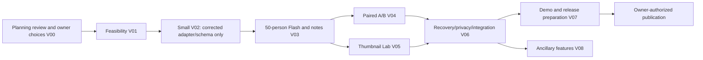

# Viralist delivery plan

## Current execution: V03 in progress

### Current checkpoint — 2026-11-01
Owner decision2026-11-01: **custom budget/accounting DEFERRED**. No more guard implementation, review, redesign or fixture cycles; preserve safe checkpoint and all history. [Scope decision and paid-execution limitation](docs/decisions-v03-product-priority.md) override all old guard dependencies. Budget worker safely stopped at clean ba6af92c429c126e51da515816432d34a81ef33c; task settled, terminal retained/user_takeover. All accounting implementation/review/fixtures DEFERRED, no integration. App candidate9c4e07c is WORKER-REPORTED, author task_3a9951dd9175 settled; author terminal cleanup release_unknown after missing old runtime terminal. Independent frozen-SHA review task_4f7cb3e4da43 / ctx_57ac41c1d5bd is active in separate tree. No guard review. Concrete task is Antigravity implementation of real Standard provider→existing scheduler/report pipeline with bounded calls, limited concurrency, no blind uncertain-charge retries and basic usage/cost reporting. Existing provider limit and30USD cumulative cap retained; dollar enforcement must be verified/reported before paid execution. Prioritize complete upload→50-instance scene-local simulation/streamed events→supported report/video evidence→refresh/recovery→deletion. No restart of product planning.

The following budget checkpoint is historical and DEFERRED:

Latest: candidate `288f349` remains independently REDESIGN-REQUIRED with7blockers despite55passing tests; [review](docs/evidence/v03-budget-redesign-review.md) and [bounded reassessment](docs/evidence/v03-budget-redesign-reassessment.md). Senior Codex exception task `task_d8317ec85c90` / dispatch `ctx_e0819319664e` is active on clean base288f349, isolated branch codex/v03-budget-senior-reassessment. Fixture a2ed497 committed and coordinator-inspected:25methods/52assertion failures/0errors; Stage B approved with actual canonical-hash qualification, acknowledged msg_2f929813af8a. Owned source implementation is active; no acceptance yet. Full assignment ba0503a; exact overflow detail pinnedb846dc2. Original2failed corrections plus failed redesigned candidate remain in history; no guard acceptance, transport or paid stage yet. The independent integrated UI journey returned [BLOCKED](docs/evidence/v03-ui-integrated-review-blocked.md): actual B report/partial A evidence, then shared runtime timeouts. No source correction failure or journey acceptance. UI processes stopped and objectstore gracefully stopped with data preserved; budget DB connectivity recovered. Run remaining heavy checks serially; no repeated UI journey until runtime cause is resolved.

Runtime blocker superseded: local V03 authorization covers the existing development database startup. PostgreSQL is running on its preserved volume and baseline `48c0a83` passed all 30 committed tests (14.031s, exit 0). Next is a gated Antigravity redesign: real failing regressions first, coordinator checkpoint, then production changes. The two historical unsuccessful corrections remain recorded. See the v2 fixture gate clarification; baseline failures are expected for the newly reproduced defects, and all criteria must pass on the redesigned candidate.

- Codex resumed Run `run_d3354faa0659`; Grok's completed work and task history are retained. No implementation worker is active.
- V03-U1 correction 2 is REVIEW-ACCEPTED at `52a09687ab33f88ab0f968460e3adbfb2a2ec50c` and INTEGRATED at `d9d3ed5aea6bd85ceca356f02e4e3321bbb312ab`. The UI still needs an independently observed browser journey on that integration commit; the last attempt was infrastructure-blocked.
- V03-B2G candidate `48c0a8398086e94320f34fbe575834957d022cab` remains WORKER-REPORTED. The independent exact-commit review returned REDESIGN after correction submission 2; [sanitized report](docs/evidence/v03-budget-correction-2-review.md). The only allowed PostgreSQL health check timed out, so tests and persistence/concurrency criteria are BLOCKED. Source review found remaining helper privacy/type validation, override, overflow, replay, reconciliation and retry defects. Do not dispatch another routine patch or rename the correction; redesign/reassess the guard and freeze a real fixture first.
- Redesign [ADR 0003](docs/adr/0003-budget-guard-redesign.md) and [contract v2](docs/contracts/budget-guard.v2.md) received independent design ACCEPT at commit `a7d0354424276fb2106c3fd9dadb068053619e5e`; [review evidence](docs/evidence/v03-budget-v2-design-review.md). The review also pinned the reconciliation enum and fingerprint serialization/storage. This is design-only: code and PostgreSQL behavior remain unaccepted. The fixture is the implementation READY gate, but its database health check timed out; prior runtime evidence excludes general Docker/service restart authority. Get owner authorization before starting the existing PostgreSQL container. No implementation dispatch until the real fixture can run on the actual database path.
- SQL004 at `c58fd52f2153b75e84a8a7ca819b3ecffe46b2b3` retains scoped acceptance for additive DDL only. It does not accept the whole guard. Fresh Standard calls remain gated on an independently accepted guard, reviewed/integrated transport and a revalidated cumulative ledger/stage.
- Provider ceiling remains $30 cumulative; last recorded estimate plus uncertainty reserve is $14.69754320. No fresh paid call, push, deployment or publication occurred in this continuation. V04/V05 and release remain out of scope.

### Historical checkpoint details — superseded by the current checkpoint above

**2026-10-31 Grok handoff:** coordinator `66129ab` was behind the workers. U1 correction `33596a6` and guard correction `58c10aa` are WORKER-REPORTED and both REVISE. Correction 2 is the last submission for each. See `docs/STATE.md` and `docs/evidence/v03-ui-correction-1-review.md`, `v03-ui-r2-assignment.md`, `v03-budget-correction-1-review.md`, `v03-budget-r2-assignment.md`. No integration and no paid call.

**Runtime available:** [restoration evidence](docs/evidence/v03-runtime-restored.md). PostgreSQL55432 and RustFS59000 passed actual connectivity checks on 2026-10-30. On 2026-10-31 those ports and the Docker engine pipe were closed again. Historical outage reports below remain evidence of previous blocked runs. Guard review at frozen8edc79b has completed REVISE; SQL004 DDL accepted separately. The full report below is history after the 2026-10-31 paragraph.

**Guard source inspection:** [coordinator findings at frozen8edc79b](docs/evidence/v03-budget-source-risks.md) identify six accounting/privacy risks for independent PostgreSQL verification. Production helper probes confirmed permissive receipt content and oversized caller context. No guard acceptance, SQL approval, correction submission, or paid call follows from source inspection.

**Current checkpoint:** U1 candidate3dfa20f remains WORKER-REPORTED and independently requires six source corrections. A delayed valid Antigravity startup receipt disproved the coordinator credit-block diagnosis; the coordinator had wrongly stopped that dispatch based on a status footer. Same-task Antigravity recovery `ctx_dba6e0dd9be6` is now READY/input-accepted at clean3dfa20f; corrected batch `msg_cfc83d44526d`, receipt approved via msg_ed270b8f70e7. No correction submitted yet; no Codex substitution. B2G candidate8edc79b remains WORKER-REPORTED with independent review now REVISE: eleven verified guard blockers; SQL004 additive DDL accepted separately. See docs/evidence/v03-budget-review-r1.md. No guard correction submitted; freeze missing identity/transaction interfaces before dispatch. Preserve all commits/history; no paid calls; existing local containers restored with original volumes.

**Independent B2G review status:** Task `task_ca196433bd63`, recovery Dispatch `ctx_d4ea4f1449fb`, settled after a read-only infrastructure report; original/recovery attempts are preserved. Reviewer confirmed frozen `8edc79b` and reported PostgreSQL connection timeout before SQL, with no test run or source edits. Coordinator’s bounded diagnosis found no listeners at known local ports5432/55432,59000 or58003 and the Docker Linux engine pipe unavailable. No ACCEPT/REVISE/REDESIGN decision, correction round, or guard acceptance. Resume only after the local DB runtime is available, using the same assigned database and frozen SHA; do not restart services as part of this task.

**U1 review result:** Codex read-only Task `task_b251aa7558f2` / Dispatch `ctx_ef6437498e1c` reviewed clean candidate3dfa20f and submitted **REVISE** for six source findings; runtime journeys/Playwright/DB fixture verification are separately **BLOCKED** by unavailable local PostgreSQL/RustFS/API/Docker. [Exact review report](docs/evidence/v03-ui-review-r1.md). The original Antigravity task `task_7459c8f8d952` remains the correction lineage; round1 requirements are [here](docs/evidence/v03-ui-r1-assignment.md). The credit-block diagnosis for stopped dispatch `ctx_65024578675d` was invalidated by delayed valid receipt `msg_fcee26449211`; same-task Antigravity recovery dispatch `ctx_dba6e0dd9be6` is awaiting its own receipt. Worktree reverified clean at3dfa20f, corrections0 submitted /0 unsuccessful. No reassignment.

**Recorded backend INTEGRATED at `5a3025c46c043b7645d935c3831f95d733f19ab5`.** [Combined checks and explicit test-isolation debt](docs/evidence/v03-backend-integrated.md). Actual50/256events/8rows,0 supported+1 withheld, owner404,266 S3HEAD404;42-test initial command41pass/1missing-owner fixture error, failed case passes with real session. U1 is now submitted at3dfa20f against exact5a3025c; [full immutable task contract](docs/evidence/v03-ui-assignment.md). Its scope includes Flash/live persisted evidence/report/player/responsive states and a narrow test setup repair. No new paid generation, independent UI review/journey acceptance, integration, release, or whole V03 completion. Older paragraphs below are history.

**U1 submission:** Task `task_7459c8f8d952` / Dispatch `ctx_7764cee17741`, Antigravity, clean candidate3dfa20f on `codex/v03-ui`, exact base5a3025c. Author report and claimed build/isolated test repair/five-browser-test evidence are in the assigned worktree; independent review is next. The UI runner/browser artifacts are author evidence only. **B2G** Task `task_2ffdc9f26a08` / Dispatch `ctx_70f1a9b3a9d4`, Antigravity, guard candidate8edc79b atop root schema004 c58fd52, [immutable contract](docs/evidence/v03-budget-assignment.md), WORKER-REPORTED. The read-only Codex review is infrastructure-BLOCKED, not a product rejection. No paid account/calls, service restart, or substitute implementation worker.

**Backend REVIEW-ACCEPTED:** `7439b6cf575016e7584fa4c6c534d5adb16d90ea`, all four original P2s and root003 resolved, [independent final evidence/qualifications](docs/evidence/v03-backend-correction-1-review.md). Same review Task51e completed through recovery Dispatch `ctx_54539de7b636`, terminal released. One submitted correction, zero unsuccessful. Coordinator integration/combined checks are next; dependent UI/live tasks wait for that committed baseline. Older review/recovery paragraphs below are historical.

2026-10-30 recovery: same review Task `task_51e4e10a717d` resumed as read-only Dispatch `ctx_54539de7b636` on clean7439b6c after old terminal failed during runtime recovery. Completed independent driver results are preserved; final disposition alone was unfinished. [Recovery contract](docs/evidence/v03-backend-r1-review-recovery.md), startup receipt verified/approved01:29:26Z. No implementation correction failure increment and no full completed test replay required without a concrete gap.

Owner authorized V03 local implementation and fresh Standard-provider smoke/benchmarking with a maximum$30 cumulative provider cap (prior tracked$14.69754320 including reserve is carried forward). Accepted V02 integration `1e140dc3db6bd9d052206cb3ae385b771d39c9dd`; current source baseline34ed67e has documentation-only changes. V02 is not being replanned/retested. V04/V05/deployment/publication remain excluded.

Run `run_d3354faa0659` is the bounded V03 namespace. First correction **`7439b6cf575016e7584fa4c6c534d5adb16d90ea`** is clean and WORKER-REPORTED; Antigravity Task `task_ec3e6a6f91f6` / Dispatch `ctx_cdfd6213b2a9` settled/released. Submitted corrections1, unsuccessful0 before review. Independent read-only recheck Task `task_51e4e10a717d` / Dispatch `ctx_1bf7991cc623`, frozen `codex/v03-backend-correction-1-review` at7439b6c, verified startup approved15:21:40Z. [Recheck contract](docs/evidence/v03-backend-correction-1-review-assignment.md). It covers the [four P2 findings](docs/evidence/v03-backend-review-1.md) against first candidatecf71ac8 plus root additive003 at5e50dab. Original author/review/correction histories and commits remain dependencies; no reset. Integrate only after independent acceptance and combined checks; UI and live-provider/budget/concurrency owners wait for accepted/frozen interface. Whole V03 remains the full goal; no fresh generation until reviewed durable guard and bounded stage.

Historical V02: final candidate1ce2abe integrated/journey-verified at1e140dc; [proof](docs/evidence/v02-integrated-journey.md). Its two failed corrections and narrow claim repair remain recorded. New V03 task budgets start at zero because this is a different owner-approved milestone, not a renamed V02 correction.

The following checkpoint paragraphs are archival, not current authority.

### Historical checkpoints (superseded by current state above)

**REVISE / correction submission 1 in progress.** Independent exact-SHA review rejected `576df904dc8e4d3034fe47e0c12f93bbf885de1f` as a complete candidate while verifying substantial recorded backend behavior. [Seven numbered blockers and observed evidence](docs/evidence/v02-review-1.md). Sole correction owner Antigravity, child task `task_82a88706eb3a` / dispatch `ctx_5438565f85de` under original V02 task; branch `codex/v02-correction-1`, exact base576df90, accepted schema715be0e. [Actual correction contract](docs/evidence/v02-correction-1-assignment.md). Fix stored UI facts/methods, recoverable terminal/deletion states, erasure scope, key binding, persisted events/progress, accessibility and evidence regressions. No redesign/readiness restart. Zero unsuccessful correction submissions; max two before reassessment. No app integration/journey acceptance or release yet.

**Candidate submitted:** `576df904dc8e4d3034fe47e0c12f93bbf885de1f` from Antigravity, clean author branch `codex/v02-antigravity`, **WORKER-REPORTED** only. Author terminal released. Independent exact-commit review task `task_92b5ca99ad57` / dispatch `ctx_a0fb7ecb985c`, frozen review worktree `codex-v02-independent-review`; [review contract](docs/evidence/v02-review-assignment.md). Reviewer is read-only Codex for significant authorization/concurrency/deletion quality, with corrections retained by Antigravity. App REVIEW-ACCEPTED/INTEGRATED/JOURNEY-VERIFIED pending; zero implementation correction submissions. Counts reported by the author are not acceptance evidence.

**2026-10-29 allocation/recovery update:** Antigravity is the default implementation owner under the permanent shared policy. The prior Codex dispatch `ctx_ffecf3a90ed0` is already failed/terminal-missing after runtime recovery; no active writer was interrupted. Original task `task_bae0a4436ee6` / Run `run_eb62638ed3eb` and review/dependency history are retained. Preserved work is committed through recovery base `c9390ee96e7ad54989011e5756807dd76ee916fa` (unverified app code), with accepted schema prerequisite `715be0ee31f8ed3229e64b75853aff624c3f449c`. New continuation checkout `codex-v02-antigravity`, branch `codex/v02-antigravity`; [updated assignment](docs/evidence/v02-assignment.md). Continue V02 directly, then independent exact-commit implementation/journey verification. Zero implementation review-correction submissions. Temporary Antigravity limits block the task pending owner-authorized reassignment; no automatic Codex substitute.

The four original V00-R1 blockers are resolved at **`715be0ee31f8ed3229e64b75853aff624c3f449c`**, independently REVIEW-ACCEPTED by Antigravity (`task_436abf78d22b`, `ctx_cb461cd2c9a7`, 18:04 UTC), then fast-forwarded into coordinator `codex/orchestration-readiness`. [Independent correction review](docs/evidence/v00-correction-review.md). One correction submission; zero failed rounds. Historical pending text below describes the submitted candidate and is superseded by this execution record.

**V02: IN PROGRESS.** Owner's local architecture/upload approval is settled. One Codex writer on `codex/v02-journey`, checkout `C:/Users/Shrikar/orca/workspaces/viralist/codex-v02-journey`, exact base and accepted prerequisite `715be0ee31f8ed3229e64b75853aff624c3f449c`; Run `run_eb62638ed3eb`. [Actual task contract](docs/evidence/v02-assignment.md). Owned app scaffolding/API/worker/UI/migrations/tests and reproducibility; coordinator owns PLAN/STATE/integration. Independent implementation review and real local browser journey remain pending.

Acceptance scope is the complete small-cast upload -> validation -> durable job -> supported note -> persistent report -> deletion journey, including recovery and owner isolation with real PostgreSQL/private S3. Hash-bound saved inference is disclosed as recorded; no new paid calls or canned findings for unmatched media. Full-Flash performance, 50-person experience, A/B, thumbnails and release remain later gates. First checkpoint: running API/migration/PG/S3 roundtrip and frontend compile; submission requires the actual UI path, not backend prerequisites alone.

Canonical local ledger: **VIR-PLAN**, now executing bounded **V00-R1** correction submission 1 before **V02**. Planning is complete. Independent initial review returned REVISE at `a2c90b5e99109d79a8ebbf2249aab0960838666a`; latest owner instruction approves local V02 stack/upload limits and implementation after correction acceptance. PLAN remains canonical until authorized tracker migration; no canonical GitHub issue exists. Current worker owns only the correction, not integration or V02. No deployment/publication/new paid calls. Further all-fifty separation is deferred.

### V00-R1 review outcome and correction batch

Independent Codex reviewer completed Orca task `task_f0e1665a723f`, dispatch `ctx_c2891d1189a6`, Run `run_78e9fa786ccc`; [assignment](docs/evidence/v00-review-assignment.md), [exact-revision findings and reproduction](docs/evidence/v00-readiness-review.md). All 25 offline experiment tests passed with external provider doubles; synthetic fixture arithmetic passed. This accepts only those observed properties, not full V01 or application readiness. Reviewer terminal released; original clean review worktree preserved. Current **correction submission 1** under V00-R1: task `task_b413039b3ddf`, dispatch `ctx_5ac751b884ef`, Run `run_eb62638ed3eb`; one of maximum two submitted correction rounds. [Correction evidence](docs/evidence/v00-correction-1.md).

The original numbered batch is unchanged in scope. Assigned correction writer owns contracts/tests and focused context updates in isolated `codex/v00-correction`, base `14cbdb036ea2ef9b8ef62f3e881c0de3d9d93e43`:

1. Derive sanitized success/incomplete/error provider examples from saved evidence, preserving source revision/hashes and explicit envelope/usage/error mapping. No paid rerun is needed for this inspection.
2. Specify C3/C5 normalization between actual experiment shapes and canonical contracts, including local action validation, timing/evidence IDs, unavailable signals and impression bounds. Do not pretend the experimental validator is the app schema.
3. Complete the synthetic report/deletion lifecycle fixture and profile-specific cast completion/failure rules. Preserve small-test versus Flash labeling and all privacy/isolation invariants.
4. Record the V02-only scope decision and accepted immutable prerequisite scope: adapter feasibility must not silently stand in for full-Flash cost/latency acceptance. The proposed $0.50 target, 60s worst-case and p95 remain unproved.

V02 stays **SPECIFIED-BLOCKED / CORRECTION-REVIEW-PENDING** until this candidate is independently accepted and the coordinator records the immutable prerequisite and dispatch baseline. Owner scope is settled; no repeated architecture/upload approval is needed. Coordinator reports PostgreSQL/private S3-compatible local preparation available; correction worker did not inspect or exercise these services. Future paid smoke needs separate authority; $15 is cumulative and nearly exhausted.

Prerequisite ownership is explicit: independent reviewer accepts/rejects the correction's exact submitted SHA; coordinator records that SHA and evidence after review, combines accepted work and records the resulting dispatch baseline. This commit cannot name its own future accepted SHA. V02 requires only (a) bounded offline scheduler/projection/budget properties independently observed at `a2c90b5e99109d79a8ebbf2249aab0960838666a`, and (b) corrected saved-adapter/schema feasibility at the to-be-reviewed correction SHA. `14cbdb036ea2ef9b8ef62f3e881c0de3d9d93e43` is the coordinator handoff base, not accepted application code. Historical paid source `04b852728ae22967f408f71e34f274911ab07578` remains WORKER-REPORTED; saved-artifact conversion does not accept the entire paid experiment. Full-Flash S2 <=$0.50, <=90s, 60s worst-case/p95 and broader fidelity/cost remain V03 gates; they do not block the authorized small V02 build. Fresh-live smoke still cannot be claimed without spend authority; exact-media saved replay is labeled recorded evidence and never fresh inference or analysis of unmatched media.

## Gates and dependency graph

V02 is locally JOURNEY-VERIFIED. V03 implementation and bounded fresh provider testing are now authorized as described above; performance and budget claims require actual new evidence. No V04/V05/release task is dispatched.

Critical path: V00 → V01 → V02 → V03 → V04 → V06 → V07. V05 joins before complete demo acceptance. Start with one implementation worker; V04/V05 can overlap only after a frozen contract and disjoint ownership receipt. V03-B1 first correction is frozen under read-only review; no active implementation writer. V04/V05 remain unauthorized in this milestone.

## Definition of Ready and Done

READY requires authorized scope, accepted immutable baseline/prerequisite SHAs, frozen contract/fixture, bounded paths/non-goals, observable checks, permitted mock boundaries, external-action authority and stop conditions. Unresolved provider shape belongs in V01, not an implementation guess.

Author “implemented” advances only to WORKER-REPORTED. Independent exact-commit checks earn REVIEW-ACCEPTED; integration and combined-revision checks earn INTEGRATED; independent real-path checks on that artifact/environment earn JOURNEY-VERIFIED; owner-authorized deployment plus release checks earn RELEASED. No stage implies another. Two unsuccessful review-correction rounds trigger recorded reassessment. Re-verification is required after code changes.

## V00 — accept decisions and establish dispatch baseline

- Behavior: a future worker knows what is authorized, which repository it owns and what evidence is required.
- Preconditions: planning exists; owner approved local stack/upload/scope on 2026-10-28. Correction exact-SHA acceptance remains pending; coordinator records baseline after review.
- Interface/ownership: assigned V00-R1 writer owns corrected reusable contracts/fixtures/tests and focused guidance; coordinator owns acceptance/integration and next dispatch.
- Check: record approved local stack/upload boundaries and exact correction SHA with independent findings; full-Flash latency/cost, release license/public footage and later Muse policy remain separate gates. Remote selection/credits/access are settled; no repeated local-scope approval.
- Real versus simulated: read actual account access/billing only when authorized; no invented credit receipt. Public event facts are not proof of selection.
- Risk/review: low implementation complexity, high dependency significance; one document review. Not parallel-safe with changes to core contracts.
- Blocker: independent exact-SHA correction acceptance. Local scope decisions are settled. No publication or paid reruns.

## V01 — bounded integration and fidelity experiments

- Owner continuation: explicitly authorized fixing the observed issues and staged Spark 1.3 reruns under the original cumulative $10 ceiling. Current source/results and live-handle recovery are recorded in STATE; the earlier blanket experiment blocker is superseded for this bounded work. Product task acceptance and deployment remain separate.
- Latest result: requested correction/rerun **WORKER-REPORTED complete** at provider source `04b852728ae22967f408f71e34f274911ab07578`; both small casts and the final 50-person stage passed. Complete local report took 88.192025s including media preparation; final run ~$0.94, so the earlier proposed $0.50 product-cost target still fails. See [full evidence](docs/evidence/spark13-rerun.md). Independent acceptance and production journeys remain pending.
- Historical baseline: [initial provider results](docs/evidence/provider-spike.md) took 177.688s for the 50-person loop and exposed audio/thumbnail issues. It is superseded by the latest corrections, not erased. Matched A/B, 60s worst-case footage, independent review and production integration remain pending.
- Behavior: establish whether the planned 50-person loop is feasible and what the actual adapter accepts.
- Preconditions for implementation acceptance: accepted V00 SHA remains pending. The owner separately authorized this experiment with two local videos, private credentials and a $10 ceiling; those inputs and access are settled.
- Interface: C2/C3/provider boundary in CONTRACTS; produce redacted real request/response fixtures, timestamp/cost tables and pass/fail conclusions. These are integration discoveries, not production journey proof.
- Ownership: `experiments/`, `docs/evidence/provider-spike.md`, proposed contract amendments through the integrator. No production UI or automatic SDK upgrades.
- Experiments (time budgets bound discovery; they do not delete product scope):

| Spike | Question/test | Pass/fail and next action | Budget |
|---|---|---|---|
| S0 | Catalog, Standard mode, one 3s owned clip, credit balance and deletion | Authorized model accepts documented request and usage is observable; otherwise record exact sanitized status and block dependent coding | 30min; within owner-authorized $10 experiment total |
| S1 | Can features preserve time and isolation? Two scene markers, known text/audio, silent control, current-only clips/frames | All required cues recovered at declared granularity; no future cue appears in early input; compare frames/native quality honestly. Resolve SDK format from docs if rejected | 45min; stop after two schema attempts |
| S2 | Can 50 personas finish affordably? Batch ≤5 active IDs/scene; actual 60s footage; include worst-case no early skips | ≥40 valid responses with visible partial handling; full 50 for normal completion, verdict ≤90s and cost ≤proposed $0.50/run. If fails, measure bottleneck and revise contract with owner, never secretly shrink cast | 90min; ≤3 runs inside total cap |
| S3 | Are notes useful and stable? Same owned A/B cuts, blinded labels, one deliberate change; swap A/B order | Supported changed-timestamp note survives order swap; unrelated notes not falsely resolved. No requirement that B always scores higher | 45min; ≤2 comparisons if cap permits |
| S4 | Can deletion truthfully complete? Enumerate and delete all uploaded provider IDs | API confirms removal and new retrieval fails; verify UI claim only covers what was checked. Outage/policy retention remains explicit | 30min; reuse prior uploads |
| S5 optional | Does one Wonder note call add value over Spark? Same evidence, blind scoring of specificity/support/faithfulness | Keep only if all three criteria are no worse and ≥1 better, with one quoted note per model and measured cost inside cap | 20min; one call/model, only after core proof |

- Mock permissions: canned malformed/429 examples for parser development; S0/S1/S2/S4 require actual provider calls. S3 is a mechanism check, not user-demand/virality validation.
- Risk/review: high, 0.5–1 day including evidence review; not parallel-safe with contract freeze. Stop at cap, geographic restriction, ambiguous charged request or two unsuccessful correction rounds. Owner decides material redesign; preserve all evidence.

## V01-DIV — measure behavioral differentiation before enlarging the library

- Owner follow-up **WORKER-REPORTED complete**: fifty strengthened cards tested in a repeated blinded text battery, plus fifty valid supplied-video opening verdicts. **$15 cumulative cap explicitly approved**, preserving all prior spend/reserve; tracked maximum $14.69754320. 832/1,225 pairs separated beyond alias noise; conservative mutually separated subset 14, so all-fifty-distinct is unproved. [Results](docs/evidence/fifty-persona-results.md). No full-video rerun, publication or product implementation claimed; no paid job remains active.

- Owner authorized starting the proposed six-policy benchmark; the original cumulative $10 provider cap still applies. This authorizes a local experiment, not product implementation or publication.
- Frozen experiment source: `3fa326c4a20f9dbc23c77e4152a2a012cdc852db`. Owned paths: `experiments/behavior/`, the optional custom-card scheduler seam, regression tests and evidence/context documents. No changes to the original 50-instance baseline.
- Interface: [fixed policies](experiments/behavior/policies.json), [preregistered protocol](experiments/behavior/PROTOCOL.md), inference-safe fixtures and separate analysis-only expectations. Six candidates, a baseline and its identical-card alias; 30 controlled clips; 608 requested viewer trials.
- Acceptance: repeat blinded judgments, preserve skip isolation and cost chain, test unchanged policies on unseen tasks, include negative/missing results and all diagnostic comparisons. Distinct names or attribute combinations cannot earn distinct-policy counts. No forced disagreement or claim of human calibration.
- Result: **WORKER-REPORTED complete**; 608 valid viewer trials / 1,206 scene decisions, zero failed personas. Only privacy reproduced its preregistered contrast in both phases; five policies remain unproven. Identical-card stable disagreement on 4/30 clips prevents treating row labels as independent behaviors. [Results and complete matrix](docs/evidence/persona-diversity-results.md). Frozen baseline remains unchanged.
- Cost: this benchmark $4.53230625 estimated; cumulative $7.72663950 plus retained $1.31327 unknown reserve, tracked maximum $9.03990950 under the original $10. All processes terminal; no charged retries or uploads. One constant disclosure-encoding discrepancy is recorded without rewriting evidence.
- Independent exact-revision review unavailable (Orca unavailable); retain WORKER-REPORTED until independently accepted. No publication, deployment or new tracker write. Product implementation and further experimental redesign remain separate work.

## V02 — one complete thin user journey

- Current state: JOURNEY-VERIFIED locally at `1e140dc3db6bd9d052206cb3ae385b771d39c9dd`; [revision-specific evidence](docs/evidence/v02-integrated-journey.md). Accepted schema prerequisite715be0e. The original task criteria below are preserved; full-Flash/live-provider gates are not accepted by this thin-slice completion.
- Behavior: owned upload → durable analysis → a small visibly labeled test cast → one supported note → delete; refresh survives processing.
- Preconditions: coordinator-recorded accepted V00-R1 correction SHA for saved-adapter/schema feasibility plus bounded offline evidence at `a2c90b5e99109d79a8ebbf2249aab0960838666a`; no full-V01 acceptance implied. Owner authorized local stack/limits and implementation. This is a test-profile slice, not completed Flash.
- Interface: C1–C5/C8, normalized-1 fixture and `contracts/normalized.py`; future app imports the same production converter exercised in correction tests. Preserve replay/live identity and exact media binding.
- Ownership: initial manifests/lockfiles, `apps/`, `contracts/`, `migrations/`, `tests/` scaffold. One writer because this crosses modules; freeze generated interface ownership before subsequent tasks.
- Acceptance: clean environment installs using committed manifests; server rejects invalid media before model dispatch; real owned clip runs through production worker/adapter to evidence-linked note; reload preserves run; another session cannot read it; delete revokes it and removes controlled objects. Record exact commands in README only after running them.
- Mocks: external model outcomes may be emulated for error tests; actual persistent PostgreSQL, worker, session checks, storage and report path must run. Exact-media recorded responses may exercise the real local adapter under recorded-evidence labeling. Fresh live inference/provider smoke remains a separate unfulfilled acceptance claim requiring new authority; no new paid calls are authorized. Never mock production scheduler, session checks or persistence to prove them.
- Non-goals/invariants: no elaborate graph, payments, calibrated scores or public share. Source/code-in-window evidence starts here, distinct from planning documents.
- Review: completed independent functional review, separate claim-repair acceptance and combined exact-commit journey verification; see current evidence. No new broad readiness review or writer is active.
- Stop: satisfy thin-slice tests at frozen SHA or report exact failure; two failed corrections require redesign.

## V03 — Flash, transparent report and live evidence view

- Behavior: 50-person Reels run streams real reactions and yields up to three actionable notes, ranges and assumptions.
- Preconditions: accepted V02 SHA; C2–C5 frozen; S2 full-Flash cost/latency, 60s worst-case and p95 gates explicitly resolved with owner before full-Flash claims. Prior ~$0.94/33.78s sample does not satisfy <=$0.50 or worst-case/p95.
- Ownership: simulation/reporting modules, run-view UI, archetype/trend data, corresponding tests. Integrator alone changes DB/contracts. Use shadcn defaults when selecting primitives and browse for actual UI path.
- Interface: trace → resample/scenario → metric/note/evidence → UI; C5 and fixture arithmetic. Implement documented subscore/method definitions, not new unexplained scoring formulas.
- Acceptance: A01/A02/A03/A07 in ACCEPTANCE; first 3s boundary, 50 actual cast instances, no future leakage, traceable notes and intervals, degraded cast clearly shown, keyboard/text alternatives and reduced motion. Repeated runs record different LLM outputs without promising determinism.
- Mock permissions: external responses for deterministic replay/regression; real 50-person run needed for performance/provider claim. A fixture screenshot cannot prove a live graph.
- Non-goals: Deep, real-world accuracy, brand superiority, calibration/fidelity numbers, additional niches. Thin grounding library warns rather than fabricates evidence.
- Risk/review: high, 1–2 days; one author plus independent verifier; no parallel work inside shared report contracts.
- Blockers/stops: latency/cost gate, supported notes, expired authorization; complete frozen test report or stop at two correction rounds.

## V04 — compare the edited cut and retain session history

- Behavior: user uploads B, sees compatible paired deltas/retention and checks whether a note's measured condition changed.
- Preconditions: accepted V03 SHA with stable C6; same-cast creation path.
- Ownership: `apps/api/app/reporting/compare*`, `apps/web/src/features/compare/`, compare/history tests. Integrator owns routes/navigation/shared schema.
- Interface: C6 base/revised manifests and paired indices; no independent-interval subtraction. Detector identity plus matching feature/timestamp mapping proposes resolution; user confirms uncertain mapping.
- Acceptance: A04 plus session ownership checks; same input negative control does not force a winner; mismatched model/config gives visible incompatibility; B is never predetermined to win; history persists within session retention.
- Mock permissions: model boundary for paired arithmetic; owned A/B must run for real to claim the demo loop.
- Non-goals: edit rendering, publishing, cross-account sharing, automatic accuracy claims.
- Risk/review: medium/high, 0.5–1 day; could parallel V05 only with frozen interface and disjoint integration ownership. Stop if alignment cannot support a note match; render uncertain instead.

## V05 — Thumbnail Lab with a permitted source

- Behavior: compare original + three thumbnail variants using a 30-person simulated panel; export chosen PNG. Intended generator is Muse Image where permitted; owned-frame/layout variants are fallback.
- Preconditions: accepted V03 SHA and C7 freeze; source-frame rights confirmed; Muse Image API access and applicable permission resolved before live generation. Playground access is owner-confirmed, not an app integration test.
- Ownership: `apps/api/app/thumbnails/`, `apps/web/src/features/thumbnails/`, thumbnail tests. Integrator owns route/schema changes; no overlap with V04 shared UI.
- Interface: C7 source provenance, actual vote counts/reasons and tie handling. Pair same panel across variants, randomize order and record it.
- Acceptance: A05; each variant records source/provider provenance. Muse Image claims require permitted actual API calls with receipts; fallback layouts are labeled. Real vote inference and distinct denominator per variant; missing/tied votes never become a guaranteed CTR improvement; exports are deletable derivatives.
- Mock permissions: external voting response for error/tie tests; live panel for integration claim. Local frame layouts are not generative-model output.
- Non-goals: alternative paid image provider selection and predicted click-through-rate calibration. Any image-generation sponsor claim must match verified use; playground access alone is insufficient evidence.
- Risk/review: medium, 0.5–1 day; optional SAM crop only if its real geometry improves an inspected output. Stop on unavailable legal input or budget; preserve lab scope as blocked rather than fabricate.

## V06 — verify failure recovery, deletion and combined journey

- Behavior: interrupted runs recover without double counting; private media remains private and deletable; combined A/B/lab works.
- Preconditions: accepted V04/V05 SHAs; integration owner combines work then freezes a new SHA. V03 acceptance does not automatically cover this revision.
- Ownership: integrator fixes shared code/migrations; independent verifier owns evidence under `docs/evidence/`. No simultaneous production writers during frozen verification.
- Interface: C1–C8; full job/event/provider artifact inventory; deletion fences and cost reservations.
- Acceptance: all applicable A01–A09 on production components; kill worker, reconnect SSE, duplicate POST, ambiguous provider timeout, no-speech, invalid media, session crossover, delete in flight, provider outage, budget exhaustion, restored backup respects tombstones. Record exact SHA, commands, environment, mock boundaries and gaps.
- Mocks: inject external rejection/outage only; use real DB/worker/renderer/storage implementation. Separate live provider deletion smoke and full owned-media browser path.
- Non-goals: enterprise certification or load beyond declared demo capacity. Anonymous public intake stays closed without quotas/abuse controls.
- Risk/review: high, ~1 day; single integrator and read-only verifier. No journey acceptance if Orca/another independent verifier unavailable; retain WORKER-REPORTED.
- Stop: two failed corrections require revised design; never patch evidence to pass.

## V07 — rehearsal and release preparation

- Behavior: a judge can follow a truthful three-minute demo and reproduce the documented build.
- Preconditions: journey-verified V06 integration SHA, owned assets, confirmed event rules and license. Source/deployment identity pinned.
- Ownership: README reproducibility, `docs/LAUNCH_STORY.md`, asset/provenance/evidence manifests, submission draft. No product changes during capture without re-verification.
- Interface: exact accepted build → real capture → optional creative pipeline → draft submission. LAUNCH_STORY defines shots and disclosures.
- Acceptance: three complete rehearsals; report observed latency/cost and failure fallback; live and recorded labels unmistakable; links accessible only after authorized publication; public repository/source license and new-work inventory checked; three-minute export inspected for captions/audio/readability.
- Real/mocked: live segment uses actual app; outage backup is visibly a recorded replay. No simulated UI footage as working integration proof.
- Risk/review: medium, ~0.5–1 day; release claims reviewed independently. Human approvals: hosting/spend, public repo, asset rights, submission, posting and release. No autonomous merges.
- Stop: prepare concrete artifacts then wait for owner release authority. Event deadline is Nov 5 07:30 IST; use Nov 3 for question resolution as reported by supplied guide, not verified official office hours.

## V08 — ancillary product behavior after core acceptance

- Behavior: hook-only partial what-if, PDF export and explicit expiring sharing improve iteration/distribution without implying an actual edited-video run.
- Preconditions: accepted V06 SHA; owner prioritization; privacy/share contracts frozen by this task before feature coding.
- Ownership: bounded new `whatif/`, `exports/`, `sharing/` modules and corresponding UI/tests; DB/routes serialized by integrator. Split into separate issues if ownership ceases to be bounded.
- Interface: hypothesis + stored feature bundle → separately labeled result; PDF carries provenance/watermark; share capability is opt-in, revocable, expiring and excluded from default uploads.
- Acceptance: modified-feature run cannot be mistaken for real B; original manifest immutable; PDF accessible/readable; revoked/expired links denied; deletion removes copies and invalidates shares. Real rendering and authorization required; provider boundary may be mocked for arithmetic only.
- Non-goals: new media render, public indexing, paywall, anonymous unrestricted share; risk medium/high, 1–2 days after scope split. Not parallel-safe with privacy migrations. Stop if share revocation/deletion cannot be demonstrated.

## Milestones and retained roadmap

M0: V00/V01 resolve feasibility; M1: V02 proves a thin real path; M2: V03–V05 prove the demo loop; M3: V06 independently checks the combined artifact; M4: V07 prepares/authorizes release. Estimates are risk indicators, not a promise to finish every item before the event. If the critical path fails, present actual status and an honestly labeled replay; do not silently cut scope or fake completion.

Retained roadmap epics (NOT READY tasks): Deep 300–500/native hybrid/full notes/unwatermarked reports → multi-platform → lawful niche benchmarks → accounts/credits/custom audience/API/sharing expansion → opt-in posted actuals/public accuracy dashboard. Larger archetype library, automated trend ingestion, richer what-if and 500-node graph performance enter those epics. Each requires its own contract and acceptance before dispatch. Calibration requires actual data and an explicit change to the current no-accuracy mandate.
