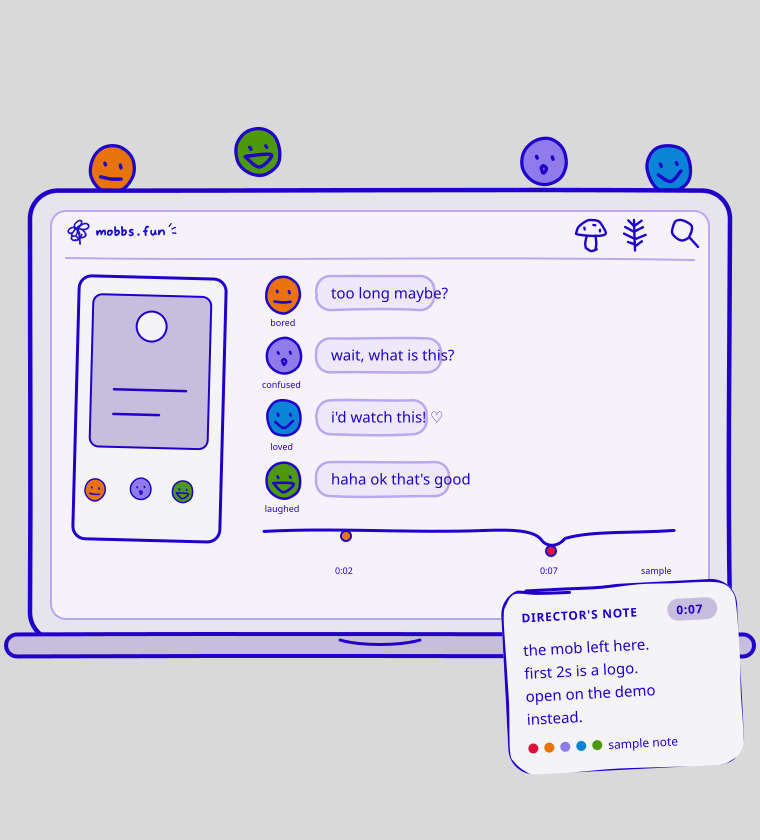
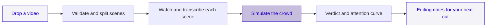
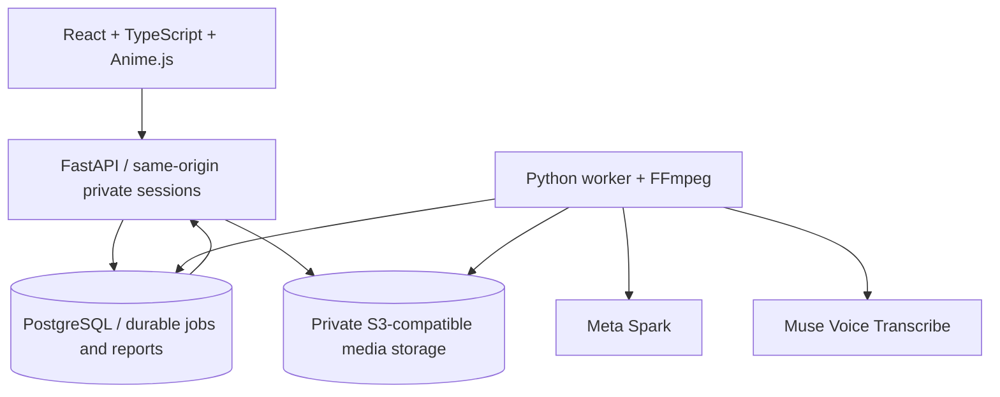

# Mobbs

**Meet your mobbs before the internet does.**

Mobbs gives short videos a small, simulated audience before you post. Drop a cut, watch a crowd of odd little personalities react, and explore where attention faded, what they would do, and what to change next.

**Current product: V03 · Flash Scan + Director’s Notes.**



[Try Mobbs](https://mobbs-fun.onrender.com) · [Explore the design](https://www.figma.com/design/HNAM1otmM0c7FUlsLK72Ub/mobbs.fun?node-id=56-56)

The hosted preview runs on Render Free. Allow about a minute to wake after inactivity. Its temporary database expires on December 5, 2026.

---

## What is Mobbs?

A private screening room for the thing you’re about to share. Mobbs watches your video scene by scene through fictional personalities with different tastes. Some stay, some leave, some would save it for later.

The result is an attention curve, simulated engagement, and timestamped editing suggestions grounded in saved reactions. These are **simulations, not real viewer feedback or predictions of views, reach, or virality**.

## Why Mobbs?

| When you’re editing | Mobbs helps you explore |
| :--- | :--- |
| Does the opening hold attention? | How many simulated viewers stay past the opening |
| Where does the cut lose people? | A scene-by-scene attention curve with video jumps |
| What would they do next? | Simulated likes, shares, saves, comments, and follows |
| What could I change? | Editing notes linked to the moment and saved reasons |

## Product

- **Flash Scan** — a cast of 50 fictional viewers, watching scene by scene.
- **Quick Preview** — a smaller 3-viewer scan for a faster first look.
- **The Mobbs Space** — brief character visits with tiny thoughts while the scan runs.
- **The Verdict** — an early opening result, followed by a full attention and engagement report.
- **Director’s Notes** — supported suggestions you can jump to in your uploaded video.
- **Private by session** — no signup; saved scans belong to your browser session. Delete a video and its app-owned derivatives, reactions, and reports together.

Full scans can take several minutes. The screen updates as scenes and reactions are saved. A partial report identifies excluded responses; missing historical signals are never invented.

---

## How it works



**Spark (`muse-spark-1.3`)** interprets physically isolated scene clips and generates persona decisions. **Muse Voice Transcribe (`muse-voice-transcribe-1.0`)** transcribes scene audio when present. Each persona receives the current scene’s frame, observations, transcript, and only its own previous impression. Once it leaves, it receives no later scenes.

The opening verdict and full report come from saved decisions. Engagement counts represent unique simulated viewers taking an action, not real platform events. Clarity and next-step understanding appear when collected. Trend fit and real-world reach are not measured. Resampling ranges describe variation within the fictional cast; they are not calibrated confidence intervals.

## Architecture



| Component | Purpose |
| :--- | :--- |
| `apps/web` | Landing page, upload, live screening room, report, and roadmap |
| `apps/api/app` | Session ownership, validated uploads, durable worker, model adapters, and deletion |
| `contracts` | Normalized reactions and evidence validation |
| `migrations` | PostgreSQL schema and immutable run manifests |
| `compose.yaml` | Local web, worker, database, and private object storage |

Provider calls have bounded concurrency and durable request markers. Accepted work is reused. Requests with unknown outcomes are not blindly retried; affected traces are excluded where safe. Shared preparation failures stop dependent work. Model credentials stay on the server.

---

## Roadmap

| Stage | Scope | Status |
| :--- | :--- | :--- |
| V03 | Flash Scan, scene audio/video, simulated engagement, Director’s Notes | Live preview |
| V04 | Compare original and edited cuts with matched casts and paired ranges | Planned |
| V05 | Thumbnail Lab with owned-frame variants and simulated voting | Planned |
| Deep | Richer context and more detailed simulations | Planned |
| Multi-platform | More formats, platform context, and comparative benchmarks | Planned |
| Accounts + API | Personal libraries, collaboration, integrations | Planned |
| Validation | Accuracy research, human-audience calibration, latency benchmarks | Future research |

---

## Getting started

### With Docker

Requires Docker Desktop or Docker Engine with Compose, and a Meta API key with access to both models.

```sh
git clone https://github.com/ShrikarT/mobbs.git
cd mobbs
cp .env.example .env
# Set MODEL_API_KEY, POSTGRES_PASSWORD and S3 credentials in .env.
docker compose up --build -d
```

Open **http://localhost:8000**. Use this exact origin; session and upload checks require it. Keep `.env` private. Use a URL-safe database password in Compose, or supply a correctly percent-encoded connection URL for native hosting.

```sh
docker compose logs -f web worker
docker compose stop
```

Stopping preserves local volumes. The first startup creates the schema and configured private bucket. Only the web port is exposed, on localhost. Model calls use your provider account and may incur charges.

### Native development

Requires Node.js 22.12+ (or 24+), Python 3.12, FFmpeg/ffprobe, PostgreSQL 17, and a private S3-compatible bucket. Export the variables in `.env.example` into your shell; native Python does not automatically load that file. Set `APP_ORIGIN` to the exact browser origin.

```sh
python -m venv .venv
# Activate the environment for your shell.
pip install -r requirements.txt
npm ci
npm run build
python -m apps.api.app.bootstrap
uvicorn apps.api.app.main:app --host 127.0.0.1 --port 8000
```

In a second terminal with the same environment:

```sh
python -m apps.api.app.worker
```

Use `python -m apps.api.app.bootstrap --create-bucket` only when you want Mobbs to create a missing local bucket. For hosted storage, provision a private bucket and use credentials limited to it. `MOBBS_RUNTIME` can alternatively point to a private JSON configuration; environment settings override it.

**Accepted uploads:** MP4, up to 60 seconds and 200,000,000 bytes. The server validates codecs, duration, resolution, frame rate, and actual decoding. A report is accessible only to the session that owns its upload. Clearing browser cookies loses access to that session; automatic retention cleanup runs in the worker after 24 hours.

### Hosting

The Docker image serves the built frontend and API together. Run a second service with `python -m apps.api.app.worker`, and provide managed PostgreSQL plus a private S3-compatible bucket. Set `APP_ORIGIN` to the public HTTPS URL; secure session cookies are enabled automatically. Set `APP_COMMIT` to the deployed Git SHA when building outside a host that supplies it.

For a temporary Render Free preview, set `MOBBS_STORAGE_BACKEND=postgres` and `MOBBS_EMBEDDED_WORKER=1`, with the free database’s internal `DATABASE_URL`. The default container command starts the API and supervises the existing worker together. Private media is stored in chunks in PostgreSQL, with the same ownership checks, video ranges, and deletion inventory. This avoids a separate paid worker and object-storage service. The standard S3/separate-worker setup remains the default for local Compose.

The free preview reserves database space for reports and cleanup, rejecting new storage before the database fills. Render’s free web instance sleeps when idle, and its free database expires after 30 days. This is a temporary demo configuration. Workspace build/bandwidth allowances and model-provider credits are separate from compute plans; selecting free resources does not establish an account-wide spending cap. Deployment status is verified separately from this source repository.

## Built with

React · TypeScript · Vite · Anime.js · FastAPI · PostgreSQL · FFmpeg · S3-compatible storage · Meta Spark · Muse Voice Transcribe.

Space Mono and Patrick Hand are self-hosted; their licenses and the Anime.js license are included with the web assets. Concept inspiration: @shubhamgl2003’s Viralist reel. Mobbs is an independent implementation.

**Made for people who make things. Built with a little chaos. ♡**
